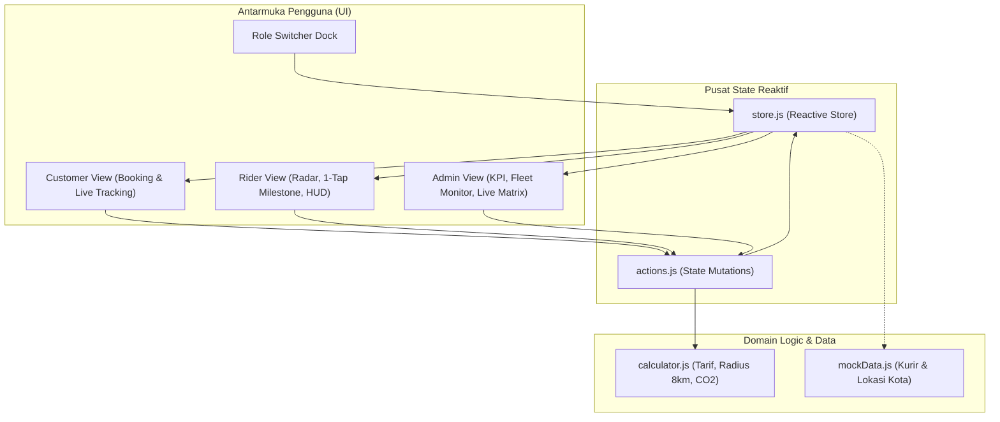

# Kurir Sepeda Implementation Plan

> **For agentic workers:** REQUIRED SUB-SKILL: Use superpowers:subagent-driven-development to implement this plan task-by-task. Steps use checkbox (`- [ ]`) syntax for tracking.

**Goal:** Membangun platform web responsif Kurir Sepeda (Bicycle Messenger Platform) yang menghubungkan Pemesan, Kurir, dan Admin/Dispatcher dalam satu sistem reaktif terpadu dengan batasan khusus sepeda (maks 8 km, muatan $\le 5\text{ kg}$, kalkulator $\text{CO}_2$, radar kurir, dan aksi 1-tap).

**Architecture:** Menggunakan arsitektur Single Page Application (SPA) berbasis Vanilla JavaScript ES Modules yang terhubung ke satu Central Reactive Store (Observer Pattern). Tiga peran utama (Customer, Rider, Dispatcher) dapat diuji secara instan melalui Role Dock Switcher di bagian atas layar.

**Architecture Diagram:**



**Tech Stack:**
* Build & Dev Server: Vite (Vanilla JS)
* Testing Framework: Vitest
* Core Logic: Modern Vanilla JavaScript (ES6+ Modules)
* Styling: Vanilla CSS (Custom Properties / Design Tokens, Grid, Flexbox)

**Spec:** [`docs/superpowers/specs/2026-10-14-kurir-sepeda-design.md`](file:///c:/Users/Mallik/Documents/kurir-sepeda/docs/superpowers/specs/2026-10-14-kurir-sepeda-design.md)

## Global Constraints
* Maksimal radius pengiriman sepeda: 8.0 km.
* Maksimal bobot barang: 5.0 kg (kategori: Dokumen, Berkas, Paket Ringan).
* Formula tarif: Rp 15.000 untuk jarak $\le 2\text{ km}$, ditambah Rp 3.500 / km berikutnya.
* Formula emisi karbon: $120\text{ gram CO}_2\text{ / km}$ terselamatkan dibanding motor.
* Area sentuh tombol aksi Kurir minimal $48 \times 48\text{px}$ (*mobile tap-friendly*).
* Standar kontras teks memenuhi WCAG AA pada palet aspal gelap (`#0F172A`) dan kuning amber kurir (`#F59E0B`).

---

### Task 1: Project Scaffolding, Design Tokens, & Base Shell

**Files:**
* Create: `package.json`
* Create: `vite.config.js`
* Create: `index.html`
* Create: `src/styles/variables.css`
* Create: `src/styles/main.css`
* Create: `src/main.js`
* Test: `tests/scaffold.test.js`

**Interfaces:**
* Consumes: None (Root setup)
* Produces:
  * CSS Variables: `--color-bg-primary`, `--color-surface`, `--color-accent-amber`, `--color-eco-green`, `--color-text-main`, `--font-sans`
  * DOM Elements: `#app`, `#role-switcher-container`, `#view-container`

- [ ] **Step 1: Write failing scaffold test**

Create `tests/scaffold.test.js`:
```javascript
import { describe, it, expect } from 'vitest';
import fs from 'fs';
import path from 'path';

describe('Project Scaffolding', () => {
  it('has valid package.json with scripts', () => {
    const pkgPath = path.resolve(__dirname, '../package.json');
    expect(fs.existsSync(pkgPath)).toBe(true);
    const pkg = JSON.parse(fs.readFileSync(pkgPath, 'utf8'));
    expect(pkg.scripts.dev).toBe('vite');
    expect(pkg.scripts.test).toBe('vitest run');
  });

  it('has index.html with mount points', () => {
    const htmlPath = path.resolve(__dirname, '../index.html');
    expect(fs.existsSync(htmlPath)).toBe(true);
    const html = fs.readFileSync(htmlPath, 'utf8');
    expect(html).toContain('id="role-switcher-container"');
    expect(html).toContain('id="view-container"');
  });
});
```

- [ ] **Step 2: Run test to verify it fails**

Run: `npm test`
Expected: FAIL (package.json / index.html not found)

- [ ] **Step 3: Create package.json, vite.config.js, index.html, variables.css, main.css, and main.js**

Create `package.json`:
```json
{
  "name": "kurir-sepeda",
  "private": true,
  "version": "1.0.0",
  "type": "module",
  "scripts": {
    "dev": "vite",
    "build": "vite build",
    "preview": "vite preview",
    "test": "vitest run"
  },
  "devDependencies": {
    "vite": "^6.0.0",
    "vitest": "^3.0.0"
  }
}
```

Create `vite.config.js`:
```javascript
import { defineConfig } from 'vite';

export default defineConfig({
  root: '.',
  server: {
    port: 3000,
    open: false
  },
  test: {
    globals: true,
    environment: 'node'
  }
});
```

Create `src/styles/variables.css`:
```css
:root {
  --color-bg-primary: #0F172A;
  --color-surface: #1E293B;
  --color-surface-hover: #334155;
  --color-border: #475569;
  --color-accent-amber: #F59E0B;
  --color-accent-yellow: #FACC15;
  --color-eco-green: #10B981;
  --color-danger: #EF4444;
  --color-text-main: #F8FAFC;
  --color-text-muted: #94A3B8;
  --font-sans: 'Inter', -apple-system, BlinkMacSystemFont, 'Segoe UI', Roboto, sans-serif;
  --font-mono: 'JetBrains Mono', monospace;
  --radius-sm: 6px;
  --radius-md: 10px;
  --radius-lg: 16px;
  --shadow-card: 0 4px 6px -1px rgba(0, 0, 0, 0.3), 0 2px 4px -2px rgba(0, 0, 0, 0.3);
}
```

Create `src/styles/main.css`:
```css
@import './variables.css';

* {
  box-sizing: border-box;
  margin: 0;
  padding: 0;
}

body {
  background-color: var(--color-bg-primary);
  color: var(--color-text-main);
  font-family: var(--font-sans);
  line-height: 1.5;
  min-height: 100vh;
  padding-bottom: 2rem;
}

#app {
  max-width: 1200px;
  margin: 0 auto;
  padding: 1rem;
}

header.app-header {
  display: flex;
  flex-direction: column;
  gap: 1rem;
  margin-bottom: 1.5rem;
}

.brand-row {
  display: flex;
  justify-content: space-between;
  align-items: center;
}

.brand-title {
  display: flex;
  align-items: center;
  gap: 0.5rem;
  font-size: 1.35rem;
  font-weight: 800;
  color: var(--color-accent-amber);
}

.brand-badge {
  background-color: rgba(16, 185, 129, 0.15);
  color: var(--color-eco-green);
  font-size: 0.75rem;
  padding: 0.2rem 0.6rem;
  border-radius: var(--radius-sm);
  border: 1px solid var(--color-eco-green);
}
```

Create `index.html`:
```html
<!DOCTYPE html>
<html lang="id">
<head>
  <meta charset="UTF-8">
  <meta name="viewport" content="width=device-width, initial-scale=1.0">
  <title>Kurir Sepeda — Urban Bicycle Messenger Platform</title>
  <link rel="stylesheet" href="./src/styles/main.css">
</head>
<body>
  <div id="app">
    <header class="app-header">
      <div class="brand-row">
        <h1 class="brand-title">🚴 KURIR SEPEDA</h1>
        <span class="brand-badge">🌱 ZERO EMISSION LOGISTICS</span>
      </div>
      <nav id="role-switcher-container"></nav>
    </header>
    <main id="view-container"></main>
  </div>
  <script type="module" src="./src/main.js"></script>
</body>
</html>
```

Create `src/main.js`:
```javascript
console.log('Kurir Sepeda initialized');
```

- [ ] **Step 4: Install dependencies and run tests**

Run: `npm install && npm test`
Expected: PASS (2 tests pass)

- [ ] **Step 5: Commit**

```bash
git add package.json vite.config.js index.html src/ tests/
git commit -m "feat: scaffold project with vite, vitest, and design tokens"
```

---

### Task 2: Domain Logic & Calculator (TDD)

**Files:**
* Create: `src/utils/calculator.js`
* Create: `tests/calculator.test.js`

**Interfaces:**
* Consumes: None
* Produces:
  * `validateDistance(distanceKm): { isValid: boolean, message?: string }`
  * `validateWeight(weightKg): { isValid: boolean, message?: string }`
  * `calculateFare(distanceKm): number`
  * `calculateCo2Saved(distanceKm): number`

- [ ] **Step 1: Write failing unit tests for calculator**

Create `tests/calculator.test.js`:
```javascript
import { describe, it, expect } from 'vitest';
import {
  validateDistance,
  validateWeight,
  calculateFare,
  calculateCo2Saved
} from '../src/utils/calculator.js';

describe('Calculator & Validation', () => {
  describe('validateDistance', () => {
    it('accepts distances within 8.0 km', () => {
      expect(validateDistance(3.5).isValid).toBe(true);
      expect(validateDistance(8.0).isValid).toBe(true);
    });

    it('rejects distances exceeding 8.0 km with descriptive safety message', () => {
      const res = validateDistance(8.5);
      expect(res.isValid).toBe(false);
      expect(res.message).toContain('melebihi batas operasional kurir sepeda');
    });

    it('rejects non-positive distance', () => {
      expect(validateDistance(0).isValid).toBe(false);
      expect(validateDistance(-2).isValid).toBe(false);
    });
  });

  describe('validateWeight', () => {
    it('accepts weights up to 5.0 kg', () => {
      expect(validateWeight(1.2).isValid).toBe(true);
      expect(validateWeight(5.0).isValid).toBe(true);
    });

    it('rejects weights exceeding 5.0 kg', () => {
      const res = validateWeight(5.5);
      expect(res.isValid).toBe(false);
      expect(res.message).toContain('melebihi kapasitas tas kurir');
    });
  });

  describe('calculateFare', () => {
    it('returns base fare of Rp 15.000 for distance <= 2 km', () => {
      expect(calculateFare(1.0)).toBe(15000);
      expect(calculateFare(2.0)).toBe(15000);
    });

    it('adds Rp 3.500 per km for distance > 2 km', () => {
      // 5 km: 15000 + (3 * 3500) = 25500
      expect(calculateFare(5.0)).toBe(25500);
      // 8 km: 15000 + (6 * 3500) = 36000
      expect(calculateFare(8.0)).toBe(36000);
    });
  });

  describe('calculateCo2Saved', () => {
    it('calculates 120 grams of CO2 saved per km', () => {
      expect(calculateCo2Saved(1.0)).toBe(120);
      expect(calculateCo2Saved(5.0)).toBe(600);
      expect(calculateCo2Saved(8.0)).toBe(960);
    });
  });
});
```

- [ ] **Step 2: Run test to verify it fails**

Run: `npm test tests/calculator.test.js`
Expected: FAIL (Cannot find module `calculator.js`)

- [ ] **Step 3: Implement calculator.js**

Create `src/utils/calculator.js`:
```javascript
export const MAX_DISTANCE_KM = 8.0;
export const MAX_WEIGHT_KG = 5.0;
export const BASE_FARE = 15000;
export const BASE_DISTANCE_KM = 2.0;
export const PER_KM_FARE = 3500;
export const CO2_PER_KM_GRAMS = 120;

export function validateDistance(distanceKm) {
  if (typeof distanceKm !== 'number' || distanceKm <= 0) {
    return { isValid: false, message: 'Jarak harus berupa angka positif.' };
  }
  if (distanceKm > MAX_DISTANCE_KM) {
    return {
      isValid: false,
      message: `Jarak pengiriman ${distanceKm} km melebihi batas operasional kurir sepeda (maksimal ${MAX_DISTANCE_KM} km demi keselamatan pesepeda).`
    };
  }
  return { isValid: true };
}

export function validateWeight(weightKg) {
  if (typeof weightKg !== 'number' || weightKg <= 0) {
    return { isValid: false, message: 'Berat harus berupa angka positif.' };
  }
  if (weightKg > MAX_WEIGHT_KG) {
    return {
      isValid: false,
      message: `Berat ${weightKg} kg melebihi kapasitas tas kurir (maksimal ${MAX_WEIGHT_KG} kg).`
    };
  }
  return { isValid: true };
}

export function calculateFare(distanceKm) {
  if (distanceKm <= BASE_DISTANCE_KM) {
    return BASE_FARE;
  }
  const extraKm = distanceKm - BASE_DISTANCE_KM;
  return BASE_FARE + Math.round(extraKm * PER_KM_FARE);
}

export function calculateCo2Saved(distanceKm) {
  return Math.round(distanceKm * CO2_PER_KM_GRAMS);
}
```

- [ ] **Step 4: Run test to verify it passes**

Run: `npm test tests/calculator.test.js`
Expected: PASS (All calculator tests pass)

- [ ] **Step 5: Commit**

```bash
git add src/utils/calculator.js tests/calculator.test.js
git commit -m "feat: add calculator logic with 8km limit, fares, and co2 formulas"
```

---

### Task 3: Central Reactive Store & Mock Data

**Files:**
* Create: `src/utils/mockData.js`
* Create: `src/state/store.js`
* Create: `src/state/actions.js`
* Create: `tests/store.test.js`

**Interfaces:**
* Consumes: `src/utils/calculator.js`
* Produces:
  * `store.getState()`, `store.subscribe(listener)`
  * `actions.setRole(role)`
  * `actions.createOrder({ pickup, dropoff, itemType, distanceKm, weightKg, senderName, senderPhone })`
  * `actions.cancelOrder(orderId)`
  * `actions.setRiderOnline(riderId, isOnline)`
  * `actions.acceptOrder(riderId, orderId)`
  * `actions.updateOrderMilestone(orderId, nextStatus)`
  * `actions.reportRiderIssue(orderId)`

- [ ] **Step 1: Write failing store tests**

Create `tests/store.test.js`:
```javascript
import { describe, it, expect, beforeEach } from 'vitest';
import { store } from '../src/state/store.js';
import * as actions from '../src/state/actions.js';

describe('Reactive Store & Actions', () => {
  beforeEach(() => {
    store.resetState();
  });

  it('initializes with default mock riders and empty orders', () => {
    const state = store.getState();
    expect(state.activeRole).toBe('customer');
    expect(state.riders.length).toBeGreaterThan(0);
    expect(state.orders).toEqual([]);
  });

  it('creates an order and notifies subscribers', () => {
    let notified = false;
    store.subscribe(() => { notified = true; });

    const order = actions.createOrder({
      pickup: 'Menara Sudirman',
      dropoff: 'Gedung Kuningan',
      itemType: 'Dokumen',
      distanceKm: 3.5,
      weightKg: 1.0,
      senderName: 'Budi',
      senderPhone: '08123456789'
    });

    expect(order.status).toBe('pending');
    expect(order.co2SavedGrams).toBe(420);
    expect(store.getState().orders.length).toBe(1);
    expect(notified).toBe(true);
  });

  it('progresses order lifecycle via rider actions', () => {
    const order = actions.createOrder({
      pickup: 'Lokasi A',
      dropoff: 'Lokasi B',
      itemType: 'Berkas',
      distanceKm: 2.0,
      weightKg: 1.0,
      senderName: 'Dewi',
      senderPhone: '08111111111'
    });

    const riderId = store.getState().riders[0].id;
    actions.acceptOrder(riderId, order.id);
    expect(store.getState().orders[0].status).toBe('accepted');
    expect(store.getState().orders[0].assignedRiderId).toBe(riderId);

    actions.updateOrderMilestone(order.id, 'picking_up');
    expect(store.getState().orders[0].status).toBe('picking_up');

    actions.updateOrderMilestone(order.id, 'in_transit');
    expect(store.getState().orders[0].status).toBe('in_transit');

    actions.updateOrderMilestone(order.id, 'delivered');
    expect(store.getState().orders[0].status).toBe('delivered');
    expect(store.getState().metrics.totalCo2Saved).toBe(240);
  });
});
```

- [ ] **Step 2: Run test to verify it fails**

Run: `npm test tests/store.test.js`
Expected: FAIL (store / actions not found)

- [ ] **Step 3: Implement mockData.js, store.js, and actions.js**

Create `src/utils/mockData.js`:
```javascript
export const INITIAL_RIDERS = [
  {
    id: 'RIDER-01',
    name: 'Dimas "Fixie" Ramadhan',
    bikeType: 'Track Bike (Fixie)',
    phone: '0812-9988-7711',
    isOnline: true,
    status: 'available', // available | on_delivery
    totalKmToday: 18.5,
    deliveriesCount: 4,
    avatar: '🚴‍♂️'
  },
  {
    id: 'RIDER-02',
    name: 'Siti "Aero" Rahma',
    bikeType: 'Road Bike Carbon',
    phone: '0813-2233-4455',
    isOnline: true,
    status: 'available',
    totalKmToday: 24.0,
    deliveriesCount: 6,
    avatar: '🚴‍♀️'
  },
  {
    id: 'RIDER-03',
    name: 'Bayu "Cargo" Pratama',
    bikeType: 'Bullitt Cargo Bike',
    phone: '0818-5566-7788',
    isOnline: false,
    status: 'offline',
    totalKmToday: 10.2,
    deliveriesCount: 2,
    avatar: '🚲'
  }
];

export const POPULAR_LOCATIONS = [
  'Menara Sudirman Kav. 60',
  'Gedung WTC Sudirman',
  'Pacific Place SCBD',
  'Plaza Senayan Trade Center',
  'Menara BTPN Mega Kuningan',
  'Gedung Bursa Efek Indonesia',
  'Kuningan City Mall Lobby'
];
```

Create `src/state/store.js`:
```javascript
import { INITIAL_RIDERS } from '../utils/mockData.js';

class ReactiveStore {
  constructor() {
    this.resetState();
  }

  resetState() {
    this.state = {
      activeRole: 'customer', // 'customer' | 'rider' | 'admin'
      orders: [],
      riders: JSON.parse(JSON.stringify(INITIAL_RIDERS)),
      metrics: {
        totalCo2Saved: 0,
        completedOrders: 0
      }
    };
    this.listeners = [];
  }

  getState() {
    return this.state;
  }

  setState(updater) {
    if (typeof updater === 'function') {
      this.state = updater(this.state);
    } else {
      this.state = { ...this.state, ...updater };
    }
    this.notify();
  }

  subscribe(listener) {
    this.listeners.push(listener);
    return () => {
      this.listeners = this.listeners.filter(l => l !== listener);
    };
  }

  notify() {
    for (const listener of this.listeners) {
      listener(this.state);
    }
  }
}

export const store = new ReactiveStore();
```

Create `src/state/actions.js`:
```javascript
import { store } from './store.js';
import { calculateFare, calculateCo2Saved, validateDistance, validateWeight } from '../utils/calculator.js';

export function setRole(newRole) {
  store.setState(state => ({
    ...state,
    activeRole: newRole
  }));
}

export function createOrder({ pickup, dropoff, itemType, distanceKm, weightKg, senderName, senderPhone }) {
  const distVal = validateDistance(distanceKm);
  if (!distVal.isValid) throw new Error(distVal.message);

  const weightVal = validateWeight(weightKg);
  if (!weightVal.isValid) throw new Error(weightVal.message);

  const newOrder = {
    id: `ORD-${Math.floor(100 + Math.random() * 900)}`,
    pickup,
    dropoff,
    itemType,
    distanceKm,
    weightKg,
    senderName,
    senderPhone,
    fare: calculateFare(distanceKm),
    co2SavedGrams: calculateCo2Saved(distanceKm),
    status: 'pending', // pending | accepted | picking_up | in_transit | delivered | cancelled
    assignedRiderId: null,
    createdAt: new Date().toISOString()
  };

  store.setState(state => ({
    ...state,
    orders: [newOrder, ...state.orders]
  }));

  return newOrder;
}

export function cancelOrder(orderId) {
  store.setState(state => {
    const order = state.orders.find(o => o.id === orderId);
    if (!order) return state;
    if (order.status === 'in_transit' || order.status === 'delivered') {
      throw new Error('Pesanan dalam perjalanan tidak dapat dibatalkan.');
    }

    const updatedRiders = state.riders.map(r => {
      if (r.id === order.assignedRiderId) {
        return { ...r, status: 'available' };
      }
      return r;
    });

    return {
      ...state,
      riders: updatedRiders,
      orders: state.orders.map(o => o.id === orderId ? { ...o, status: 'cancelled' } : o)
    };
  });
}

export function setRiderOnline(riderId, isOnline) {
  store.setState(state => ({
    ...state,
    riders: state.riders.map(r => r.id === riderId ? {
      ...r,
      isOnline,
      status: isOnline ? (r.status === 'offline' ? 'available' : r.status) : 'offline'
    } : r)
  }));
}

export function acceptOrder(riderId, orderId) {
  store.setState(state => {
    const order = state.orders.find(o => o.id === orderId);
    const rider = state.riders.find(r => r.id === riderId);
    if (!order || !rider || order.status !== 'pending') return state;

    return {
      ...state,
      orders: state.orders.map(o => o.id === orderId ? {
        ...o,
        status: 'accepted',
        assignedRiderId: riderId
      } : o),
      riders: state.riders.map(r => r.id === riderId ? {
        ...r,
        status: 'on_delivery'
      } : r)
    };
  });
}

export function updateOrderMilestone(orderId, nextStatus) {
  store.setState(state => {
    const order = state.orders.find(o => o.id === orderId);
    if (!order) return state;

    let updatedMetrics = { ...state.metrics };
    let updatedRiders = [...state.riders];

    if (nextStatus === 'delivered') {
      updatedMetrics.completedOrders += 1;
      updatedMetrics.totalCo2Saved += order.co2SavedGrams;

      updatedRiders = updatedRiders.map(r => {
        if (r.id === order.assignedRiderId) {
          return {
            ...r,
            status: 'available',
            totalKmToday: Number((r.totalKmToday + order.distanceKm).toFixed(1)),
            deliveriesCount: r.deliveriesCount + 1
          };
        }
        return r;
      });
    }

    return {
      ...state,
      metrics: updatedMetrics,
      riders: updatedRiders,
      orders: state.orders.map(o => o.id === orderId ? { ...o, status: nextStatus } : o)
    };
  });
}

export function reportRiderIssue(orderId) {
  store.setState(state => {
    const order = state.orders.find(o => o.id === orderId);
    if (!order) return state;

    return {
      ...state,
      orders: state.orders.map(o => o.id === orderId ? {
        ...o,
        status: 'pending',
        assignedRiderId: null
      } : o),
      riders: state.riders.map(r => r.id === order.assignedRiderId ? {
        ...r,
        status: 'offline',
        isOnline: false
      } : r)
    };
  });
}
```

- [ ] **Step 4: Run test to verify it passes**

Run: `npm test tests/store.test.js`
Expected: PASS (All store and action tests pass)

- [ ] **Step 5: Commit**

```bash
git add src/state/ src/utils/mockData.js tests/store.test.js
git commit -m "feat: implement reactive store, actions, and mock data"
```

---

### Task 4: Role Switcher Dock Component & App Integration

**Files:**
* Create: `src/components/roleSwitcher.js`
* Modify: `src/styles/main.css`
* Modify: `src/main.js`

**Interfaces:**
* Consumes: `src/state/store.js`, `src/state/actions.js`
* Produces:
  * `renderRoleSwitcher(containerElement)`: mounts the 3-role navigation bar with live status badges

- [ ] **Step 1: Implement roleSwitcher.js**

Create `src/components/roleSwitcher.js`:
```javascript
import { store } from '../state/store.js';
import { setRole } from '../state/actions.js';

export function renderRoleSwitcher(container) {
  function update() {
    const { activeRole, orders, riders } = store.getState();
    const pendingOrdersCount = orders.filter(o => o.status === 'pending').length;
    const activeRidersCount = riders.filter(r => r.isOnline).length;

    container.innerHTML = `
      <div class="role-dock" role="tablist" aria-label="Pilih Peran">
        <button class="role-btn ${activeRole === 'customer' ? 'active' : ''}" data-role="customer">
          <span class="role-icon">👤</span>
          <span class="role-label">Pemesan</span>
        </button>
        <button class="role-btn ${activeRole === 'rider' ? 'active' : ''}" data-role="rider">
          <span class="role-icon">🚴</span>
          <span class="role-label">Kurir Sepeda</span>
          ${pendingOrdersCount > 0 ? `<span class="badge-alert">${pendingOrdersCount}</span>` : ''}
        </button>
        <button class="role-btn ${activeRole === 'admin' ? 'active' : ''}" data-role="admin">
          <span class="role-icon">🏢</span>
          <span class="role-label">Dispatcher / Admin</span>
          <span class="badge-info">${activeRidersCount} Siap</span>
        </button>
      </div>
    `;

    container.querySelectorAll('.role-btn').forEach(btn => {
      btn.addEventListener('click', () => {
        const role = btn.getAttribute('data-role');
        setRole(role);
      });
    });
  }

  store.subscribe(update);
  update();
}
```

- [ ] **Step 2: Add role dock styles to `src/styles/main.css`**

Append to `src/styles/main.css`:
```css
.role-dock {
  display: flex;
  background-color: var(--color-surface);
  border: 1px solid var(--color-border);
  border-radius: var(--radius-lg);
  padding: 0.35rem;
  gap: 0.5rem;
  box-shadow: var(--shadow-card);
}

.role-btn {
  flex: 1;
  display: flex;
  align-items: center;
  justify-content: center;
  gap: 0.5rem;
  background: transparent;
  color: var(--color-text-muted);
  border: none;
  padding: 0.75rem 1rem;
  border-radius: var(--radius-md);
  font-family: var(--font-sans);
  font-size: 0.95rem;
  font-weight: 600;
  cursor: pointer;
  transition: all 0.2s ease;
  min-height: 48px;
}

.role-btn:hover {
  color: var(--color-text-main);
  background-color: var(--color-surface-hover);
}

.role-btn.active {
  background-color: var(--color-accent-amber);
  color: #000;
  font-weight: 800;
}

.badge-alert {
  background-color: var(--color-danger);
  color: white;
  font-size: 0.75rem;
  font-weight: 800;
  padding: 0.15rem 0.5rem;
  border-radius: 999px;
  animation: pulse 1.5s infinite;
}

.badge-info {
  background-color: rgba(255, 255, 255, 0.2);
  color: inherit;
  font-size: 0.75rem;
  padding: 0.15rem 0.45rem;
  border-radius: 999px;
}

@keyframes pulse {
  0%, 100% { opacity: 1; transform: scale(1); }
  50% { opacity: 0.85; transform: scale(1.05); }
}

@media (max-width: 640px) {
  .role-dock {
    flex-direction: column;
  }
}
```

- [ ] **Step 3: Connect in main.js**

Update `src/main.js`:
```javascript
import { renderRoleSwitcher } from './components/roleSwitcher.js';

const roleContainer = document.getElementById('role-switcher-container');
renderRoleSwitcher(roleContainer);
```

- [ ] **Step 4: Verify test suite still passes**

Run: `npm test`
Expected: PASS

- [ ] **Step 5: Commit**

```bash
git add src/components/roleSwitcher.js src/styles/main.css src/main.js
git commit -m "feat: add role switcher dock component with live order and rider counters"
```

---

### Task 5: Customer View Component (Form Booking, Kalkulator, & Tracking)

**Files:**
* Create: `src/styles/customer.css`
* Create: `src/components/customerView.js`
* Modify: `src/main.js`

**Interfaces:**
* Consumes: `src/state/store.js`, `src/state/actions.js`, `src/utils/calculator.js`, `src/utils/mockData.js`
* Produces:
  * `renderCustomerView(viewContainer)`: Form pemesanan dengan auto-kalkulasi jarak/tarif/CO2, validasi batas 8 km, dan kartu pelacakan real-time untuk order yang baru dibuat.

- [ ] **Step 1: Create `src/styles/customer.css`**

Create `src/styles/customer.css`:
```css
.customer-grid {
  display: grid;
  grid-template-columns: 1fr 1fr;
  gap: 1.5rem;
  margin-top: 1rem;
}

.card {
  background-color: var(--color-surface);
  border: 1px solid var(--color-border);
  border-radius: var(--radius-lg);
  padding: 1.5rem;
  box-shadow: var(--shadow-card);
}

.card-title {
  font-size: 1.2rem;
  font-weight: 700;
  margin-bottom: 1.25rem;
  color: var(--color-accent-amber);
  display: flex;
  align-items: center;
  gap: 0.5rem;
}

.form-group {
  margin-bottom: 1.2rem;
}

.form-group label {
  display: block;
  font-size: 0.85rem;
  font-weight: 600;
  color: var(--color-text-muted);
  margin-bottom: 0.4rem;
}

.form-control {
  width: 100%;
  padding: 0.75rem;
  background-color: var(--color-bg-primary);
  border: 1px solid var(--color-border);
  border-radius: var(--radius-sm);
  color: var(--color-text-main);
  font-family: var(--font-sans);
  font-size: 0.95rem;
}

.form-control:focus {
  outline: 2px solid var(--color-accent-amber);
}

.calc-summary-box {
  background: rgba(15, 23, 42, 0.6);
  border: 1px dashed var(--color-border);
  border-radius: var(--radius-md);
  padding: 1rem;
  margin-top: 1rem;
  margin-bottom: 1.25rem;
}

.calc-row {
  display: flex;
  justify-content: space-between;
  margin-bottom: 0.5rem;
  font-size: 0.9rem;
}

.calc-row.total {
  font-size: 1.15rem;
  font-weight: 800;
  color: var(--color-accent-yellow);
  border-top: 1px solid var(--color-border);
  padding-top: 0.5rem;
  margin-top: 0.5rem;
}

.eco-pill {
  display: inline-flex;
  align-items: center;
  gap: 0.4rem;
  background-color: rgba(16, 185, 129, 0.15);
  color: var(--color-eco-green);
  font-weight: 700;
  font-size: 0.85rem;
  padding: 0.35rem 0.75rem;
  border-radius: 999px;
  border: 1px solid rgba(16, 185, 129, 0.3);
  margin-top: 0.5rem;
}

.btn-primary {
  width: 100%;
  background-color: var(--color-accent-amber);
  color: #000;
  font-weight: 800;
  font-size: 1rem;
  padding: 0.9rem;
  border: none;
  border-radius: var(--radius-md);
  cursor: pointer;
  transition: opacity 0.2s;
  min-height: 48px;
}

.btn-primary:hover:not(:disabled) {
  opacity: 0.9;
}

.btn-primary:disabled {
  background-color: #475569;
  color: #94A3B8;
  cursor: not-allowed;
}

.alert-box {
  background-color: rgba(239, 68, 68, 0.15);
  border: 1px solid var(--color-danger);
  color: #FCA5A5;
  padding: 0.75rem;
  border-radius: var(--radius-sm);
  font-size: 0.85rem;
  margin-bottom: 1rem;
}

/* Stepper Status */
.stepper {
  display: flex;
  flex-direction: column;
  gap: 1rem;
  margin-top: 1rem;
}

.step-item {
  display: flex;
  gap: 0.75rem;
  align-items: flex-start;
}

.step-circle {
  width: 28px;
  height: 28px;
  border-radius: 50%;
  background-color: var(--color-surface-hover);
  color: var(--color-text-muted);
  display: flex;
  align-items: center;
  justify-content: center;
  font-size: 0.8rem;
  font-weight: bold;
}

.step-item.active .step-circle {
  background-color: var(--color-accent-amber);
  color: #000;
}

.step-item.done .step-circle {
  background-color: var(--color-eco-green);
  color: white;
}

@media (max-width: 768px) {
  .customer-grid {
    grid-template-columns: 1fr;
  }
}
```

- [ ] **Step 2: Implement `src/components/customerView.js`**

Create `src/components/customerView.js`:
```javascript
import { store } from '../state/store.js';
import { createOrder, cancelOrder } from '../state/actions.js';
import { calculateFare, calculateCo2Saved, validateDistance, MAX_DISTANCE_KM } from '../utils/calculator.js';
import { POPULAR_LOCATIONS } from '../utils/mockData.js';

export function renderCustomerView(container) {
  let distanceKm = 3.5;
  let weightKg = 1.0;
  let validationError = null;

  function update() {
    const { orders, riders } = store.getState();
    const activeOrder = orders.find(o => o.status !== 'delivered' && o.status !== 'cancelled');
    const assignedRider = activeOrder ? riders.find(r => r.id === activeOrder.assignedRiderId) : null;

    const fare = calculateFare(distanceKm);
    const co2 = calculateCo2Saved(distanceKm);
    const distCheck = validateDistance(distanceKm);

    container.innerHTML = `
      <div class="customer-grid">
        <section class="card" aria-labelledby="booking-heading">
          <h2 id="booking-heading" class="card-title">📦 Buat Pesanan Baru</h2>
          
          ${validationError ? `<div class="alert-box">${validationError}</div>` : ''}

          <form id="order-form">
            <div class="form-group">
              <label for="pickup-select">Titik Penjemputan</label>
              <select id="pickup-select" class="form-control" required>
                ${POPULAR_LOCATIONS.map((loc, idx) => `<option value="${loc}" ${idx === 0 ? 'selected' : ''}>${loc}</option>`).join('')}
              </select>
            </div>

            <div class="form-group">
              <label for="dropoff-select">Titik Pengantaran</label>
              <select id="dropoff-select" class="form-control" required>
                ${POPULAR_LOCATIONS.map((loc, idx) => `<option value="${loc}" ${idx === 1 ? 'selected' : ''}>${loc}</option>`).join('')}
              </select>
            </div>

            <div class="form-group">
              <label for="item-type">Jenis Barang (Maks 5 kg)</label>
              <select id="item-type" class="form-control">
                <option value="Dokumen / Surat Segel">Dokumen / Surat Resmi</option>
                <option value="Map Berkas Kantor">Map Berkas Kontrak</option>
                <option value="Paket Kecil / Sampel">Paket Kotak Ringan (&le; 5 kg)</option>
              </select>
            </div>

            <div class="form-group">
              <label for="distance-range">Simulasi Jarak: <strong id="dist-label">${distanceKm} km</strong></label>
              <input type="range" id="distance-range" class="form-control" min="0.5" max="12.0" step="0.5" value="${distanceKm}">
            </div>

            <div class="calc-summary-box">
              <div class="calc-row">
                <span>Batas Radius Sepeda</span>
                <span>${distCheck.isValid ? '✅ Dalam Radius Aman' : '❌ Melebihi Batas'}</span>
              </div>
              <div class="calc-row">
                <span>Estimasi Jarak</span>
                <span>${distanceKm} km</span>
              </div>
              <div class="calc-row">
                <span>Dampak Lingkungan</span>
                <span class="eco-pill">🌱 Hemat ~${co2}g CO₂</span>
              </div>
              <div class="calc-row total">
                <span>Total Tarif</span>
                <span>Rp ${fare.toLocaleString('id-ID')}</span>
              </div>
            </div>

            <button type="submit" class="btn-primary" ${!distCheck.isValid ? 'disabled' : ''}>
              ${distCheck.isValid ? '🚴‍♂️ Panggil Kurir Sepeda Sekarang' : `⚠️ Maksimal Jarak ${MAX_DISTANCE_KM} km`}
            </button>
          </form>
        </section>

        <section class="card" aria-labelledby="status-heading">
          <h2 id="status-heading" class="card-title">📍 Pelacakan Pesanan Aktif</h2>
          
          ${activeOrder ? `
            <div class="active-order-box">
              <div style="display:flex; justify-content:space-between; align-items:center; margin-bottom:1rem;">
                <strong>${activeOrder.id}</strong>
                <span class="brand-badge">${activeOrder.status.toUpperCase()}</span>
              </div>
              <p style="font-size:0.9rem; color:var(--color-text-muted);">
                ${activeOrder.pickup} &rarr; ${activeOrder.dropoff} (${activeOrder.distanceKm} km)
              </p>

              <div class="stepper">
                <div class="step-item ${activeOrder.status === 'pending' ? 'active' : 'done'}">
                  <div class="step-circle">1</div>
                  <div>
                    <strong>Mencari Kurir Terdekat</strong>
                    <p style="font-size:0.8rem; color:var(--color-text-muted);">Pesanan masuk radar pesepeda kota</p>
                  </div>
                </div>
                <div class="step-item ${activeOrder.status === 'accepted' ? 'active' : (['picking_up', 'in_transit', 'delivered'].includes(activeOrder.status) ? 'done' : '')}">
                  <div class="step-circle">2</div>
                  <div>
                    <strong>Kurir Ditugaskan</strong>
                    <p style="font-size:0.8rem; color:var(--color-text-muted);">${assignedRider ? `${assignedRider.name} (${assignedRider.bikeType})` : 'Menunggu kurir mengambil'}</p>
                  </div>
                </div>
                <div class="step-item ${activeOrder.status === 'in_transit' ? 'active' : (activeOrder.status === 'delivered' ? 'done' : '')}">
                  <div class="step-circle">3</div>
                  <div>
                    <strong>Dalam Tas & Sedang Gowes</strong>
                    <p style="font-size:0.8rem; color:var(--color-text-muted);">Paket meluncur cepat bebas macet</p>
                  </div>
                </div>
                <div class="step-item ${activeOrder.status === 'delivered' ? 'done' : ''}">
                  <div class="step-circle">4</div>
                  <div>
                    <strong>Sampai di Tujuan</strong>
                    <p style="font-size:0.8rem; color:var(--color-text-muted);">Pengantaran selesai!</p>
                  </div>
                </div>
              </div>

              ${['pending', 'accepted'].includes(activeOrder.status) ? `
                <button id="btn-cancel-order" class="btn-primary" style="margin-top:1.5rem; background-color:transparent; border:1px solid var(--color-danger); color:var(--color-danger);">
                  Batalkan Pesanan
                </button>
              ` : ''}
            </div>
          ` : `
            <p style="color:var(--color-text-muted); text-align:center; padding:2rem 0;">
              Belum ada pesanan aktif. Buat pesanan baru untuk mencoba alur kurir sepeda.
            </p>
          `}
        </section>
      </div>
    `;

    const rangeInput = container.querySelector('#distance-range');
    if (rangeInput) {
      rangeInput.addEventListener('input', (e) => {
        distanceKm = parseFloat(e.target.value);
        validationError = null;
        update();
      });
    }

    const form = container.querySelector('#order-form');
    if (form) {
      form.addEventListener('submit', (e) => {
        e.preventDefault();
        try {
          const pickup = container.querySelector('#pickup-select').value;
          const dropoff = container.querySelector('#dropoff-select').value;
          const itemType = container.querySelector('#item-type').value;

          if (pickup === dropoff) {
            validationError = 'Titik jemput dan antar tidak boleh sama!';
            update();
            return;
          }

          createOrder({
            pickup,
            dropoff,
            itemType,
            distanceKm,
            weightKg,
            senderName: 'Pengguna Kantor',
            senderPhone: '0812-3344-5566'
          });
          validationError = null;
        } catch (err) {
          validationError = err.message;
          update();
        }
      });
    }

    const cancelBtn = container.querySelector('#btn-cancel-order');
    if (cancelBtn && activeOrder) {
      cancelBtn.addEventListener('click', () => {
        cancelOrder(activeOrder.id);
      });
    }
  }

  store.subscribe(update);
  update();
}
```

- [ ] **Step 3: Connect customerView in main.js with dynamic view routing**

Update `src/main.js`:
```javascript
import './styles/main.css';
import './styles/customer.css';
import { store } from './state/store.js';
import { renderRoleSwitcher } from './components/roleSwitcher.js';
import { renderCustomerView } from './components/customerView.js';

const roleContainer = document.getElementById('role-switcher-container');
const viewContainer = document.getElementById('view-container');

renderRoleSwitcher(roleContainer);

function renderCurrentView() {
  const { activeRole } = store.getState();
  viewContainer.innerHTML = '';

  if (activeRole === 'customer') {
    renderCustomerView(viewContainer);
  } else if (activeRole === 'rider') {
    viewContainer.innerHTML = '<div class="card"><h2 class="card-title">🚴 Radar Kurir Sepeda</h2><p>Kurir View Placeholder</p></div>';
  } else if (activeRole === 'admin') {
    viewContainer.innerHTML = '<div class="card"><h2 class="card-title">🏢 Dispatcher Dashboard</h2><p>Admin View Placeholder</p></div>';
  }
}

store.subscribe(renderCurrentView);
renderCurrentView();
```

- [ ] **Step 4: Run tests to ensure no regressions**

Run: `npm test`
Expected: PASS

- [ ] **Step 5: Commit**

```bash
git add src/styles/customer.css src/components/customerView.js src/main.js
git commit -m "feat: implement customer booking view with live distance validation and co2 calculator"
```

---

### Task 6: Rider View Component (Radar Order, 1-Tap Milestone Actions, & HUD)

**Files:**
* Create: `src/styles/rider.css`
* Create: `src/components/riderView.js`
* Modify: `src/main.js`

**Interfaces:**
* Consumes: `src/state/store.js`, `src/state/actions.js`
* Produces:
  * `renderRiderView(viewContainer)`: Menampilkan status online kurir, radar pesanan `pending` dengan tombol aksi 1-tap, alur milestone pengambilan hingga pengantaran selesai, dan tombol kendala jalan.

- [ ] **Step 1: Create `src/styles/rider.css`**

Create `src/styles/rider.css`:
```css
.rider-container {
  display: flex;
  flex-direction: column;
  gap: 1.5rem;
}

.rider-hud {
  display: grid;
  grid-template-columns: repeat(3, 1fr);
  gap: 1rem;
  background-color: var(--color-surface);
  border: 1px solid var(--color-border);
  border-radius: var(--radius-lg);
  padding: 1.25rem;
  box-shadow: var(--shadow-card);
}

.hud-item {
  text-align: center;
}

.hud-value {
  font-size: 1.6rem;
  font-weight: 800;
  color: var(--color-accent-yellow);
  font-family: var(--font-mono);
}

.hud-label {
  font-size: 0.8rem;
  color: var(--color-text-muted);
}

.order-card {
  background-color: var(--color-surface);
  border: 2px solid var(--color-border);
  border-radius: var(--radius-lg);
  padding: 1.25rem;
  margin-bottom: 1rem;
  transition: border-color 0.2s;
}

.order-card.priority {
  border-color: var(--color-accent-amber);
}

.btn-action-large {
  width: 100%;
  min-height: 54px;
  background-color: var(--color-accent-amber);
  color: #000;
  font-size: 1.1rem;
  font-weight: 800;
  border: none;
  border-radius: var(--radius-md);
  cursor: pointer;
  margin-top: 1rem;
  display: flex;
  align-items: center;
  justify-content: center;
  gap: 0.5rem;
}

.btn-issue {
  width: 100%;
  min-height: 48px;
  background-color: transparent;
  color: var(--color-danger);
  border: 1px dashed var(--color-danger);
  border-radius: var(--radius-md);
  cursor: pointer;
  font-weight: 700;
  margin-top: 0.75rem;
}

@media (max-width: 640px) {
  .rider-hud {
    grid-template-columns: 1fr;
    gap: 0.75rem;
  }
}
```

- [ ] **Step 2: Implement `src/components/riderView.js`**

Create `src/components/riderView.js`:
```javascript
import { store } from '../state/store.js';
import { acceptOrder, updateOrderMilestone, reportRiderIssue, setRiderOnline } from '../state/actions.js';

export function renderRiderView(container) {
  let selectedRiderId = 'RIDER-01';

  function update() {
    const { riders, orders } = store.getState();
    const currentRider = riders.find(r => r.id === selectedRiderId) || riders[0];
    const assignedOrder = orders.find(o => o.assignedRiderId === currentRider.id && o.status !== 'delivered' && o.status !== 'cancelled');
    const pendingOrders = orders.filter(o => o.status === 'pending');

    container.innerHTML = `
      <div class="rider-container">
        <!-- Rider Selector & Online Toggle -->
        <div class="card" style="display:flex; justify-content:space-between; align-items:center; flex-wrap:wrap; gap:1rem;">
          <div style="display:flex; align-items:center; gap:0.75rem;">
            <span style="font-size:2rem;">${currentRider.avatar}</span>
            <div>
              <select id="rider-select" class="form-control" style="font-weight:700;">
                ${riders.map(r => `<option value="${r.id}" ${r.id === currentRider.id ? 'selected' : ''}>${r.name} (${r.bikeType})</option>`).join('')}
              </select>
              <span style="font-size:0.8rem; color:var(--color-text-muted);">${currentRider.bikeType}</span>
            </div>
          </div>
          <button id="toggle-online-btn" class="btn-primary" style="width:auto; min-width:140px; background-color:${currentRider.isOnline ? 'var(--color-eco-green)' : 'var(--color-border)'}; color:white;">
            ${currentRider.isOnline ? '🟢 Siap Gowes' : '⚪ Istirahat'}
          </button>
        </div>

        <!-- HUD Odometer Harian -->
        <div class="rider-hud">
          <div class="hud-item">
            <div class="hud-value">${currentRider.totalKmToday} km</div>
            <div class="hud-label">Jarak Gowes Hari Ini</div>
          </div>
          <div class="hud-item">
            <div class="hud-value">${currentRider.deliveriesCount}</div>
            <div class="hud-label">Pengantaran Sukses</div>
          </div>
          <div class="hud-item">
            <div class="hud-value">Rp ${(currentRider.deliveriesCount * 22000).toLocaleString('id-ID')}</div>
            <div class="hud-label">Estimasi Komisi</div>
          </div>
        </div>

        <!-- Active Delivery Card OR Radar Available Orders -->
        ${assignedOrder ? `
          <div class="order-card priority">
            <div style="display:flex; justify-content:space-between; align-items:center;">
              <span class="brand-badge">SEDANG MENJALANKAN ORDER</span>
              <strong style="color:var(--color-accent-yellow);">${assignedOrder.id}</strong>
            </div>

            <div style="margin:1rem 0;">
              <p><strong>Jemput:</strong> ${assignedOrder.pickup}</p>
              <p><strong>Antar:</strong> ${assignedOrder.dropoff}</p>
              <p><strong>Barang:</strong> ${assignedOrder.itemType} (${assignedOrder.distanceKm} km)</p>
            </div>

            ${assignedOrder.status === 'accepted' ? `
              <button id="btn-milestone-pickup" class="btn-action-large">
                📍 1. Tiba di Titik Jemput
              </button>
            ` : ''}

            ${assignedOrder.status === 'picking_up' ? `
              <button id="btn-milestone-transit" class="btn-action-large">
                🎒 2. Paket Masuk Tas & Mulai Gowes
              </button>
            ` : ''}

            ${assignedOrder.status === 'in_transit' ? `
              <button id="btn-milestone-delivered" class="btn-action-large" style="background-color:var(--color-eco-green); color:white;">
                🏁 3. Konfirmasi Pengiriman Selesai!
              </button>
            ` : ''}

            <button id="btn-report-issue" class="btn-issue">
              ⚠️ Laporkan Kendala / Ban Bocor
            </button>
          </div>
        ` : `
          <div class="card">
            <h2 class="card-title">📡 Radar Pesanan Masuk (${pendingOrders.length})</h2>
            ${!currentRider.isOnline ? `
              <p style="color:var(--color-text-muted); text-align:center; padding:1.5rem 0;">
                Status Anda sedang <strong>Istirahat (Offline)</strong>. Nyalakan status "Siap Gowes" untuk mendeteksi order.
              </p>
            ` : (pendingOrders.length > 0 ? `
              <div class="pending-list">
                ${pendingOrders.map(order => `
                  <div class="order-card">
                    <div style="display:flex; justify-content:space-between; align-items:center;">
                      <strong style="color:var(--color-accent-amber);">${order.id}</strong>
                      <span class="eco-pill">🚴 ${order.distanceKm} km</span>
                    </div>
                    <div style="margin:0.75rem 0;">
                      <p><strong>Jemput:</strong> ${order.pickup}</p>
                      <p><strong>Antar:</strong> ${order.dropoff}</p>
                      <p><strong>Muatan:</strong> ${order.itemType} | Upah: <strong>Rp ${order.fare.toLocaleString('id-ID')}</strong></p>
                    </div>
                    <button class="btn-action-large btn-accept-order" data-order-id="${order.id}">
                      Ambil Order Ini ⚡
                    </button>
                  </div>
                `).join('')}
              </div>
            ` : `
              <p style="color:var(--color-text-muted); text-align:center; padding:2rem 0;">
                Belum ada pesanan masuk di radar. Tunggu pesanan dari Pemesan.
              </p>
            `)}
          </div>
        `}
      </div>
    `;

    // Event Listeners
    const riderSelect = container.querySelector('#rider-select');
    if (riderSelect) {
      riderSelect.addEventListener('change', (e) => {
        selectedRiderId = e.target.value;
        update();
      });
    }

    const toggleOnlineBtn = container.querySelector('#toggle-online-btn');
    if (toggleOnlineBtn) {
      toggleOnlineBtn.addEventListener('click', () => {
        setRiderOnline(currentRider.id, !currentRider.isOnline);
      });
    }

    container.querySelectorAll('.btn-accept-order').forEach(btn => {
      btn.addEventListener('click', () => {
        const orderId = btn.getAttribute('data-order-id');
        acceptOrder(currentRider.id, orderId);
      });
    });

    const btnPickup = container.querySelector('#btn-milestone-pickup');
    if (btnPickup && assignedOrder) {
      btnPickup.addEventListener('click', () => updateOrderMilestone(assignedOrder.id, 'picking_up'));
    }

    const btnTransit = container.querySelector('#btn-milestone-transit');
    if (btnTransit && assignedOrder) {
      btnTransit.addEventListener('click', () => updateOrderMilestone(assignedOrder.id, 'in_transit'));
    }

    const btnDelivered = container.querySelector('#btn-milestone-delivered');
    if (btnDelivered && assignedOrder) {
      btnDelivered.addEventListener('click', () => updateOrderMilestone(assignedOrder.id, 'delivered'));
    }

    const btnIssue = container.querySelector('#btn-report-issue');
    if (btnIssue && assignedOrder) {
      btnIssue.addEventListener('click', () => {
        if (confirm('Laporkan kendala di jalan? Order akan dikembalikan ke radar kurir lain.')) {
          reportRiderIssue(assignedOrder.id);
        }
      });
    }
  }

  store.subscribe(update);
  update();
}
```

- [ ] **Step 3: Connect in main.js**

Update `src/main.js` to mount `renderRiderView`:
```javascript
import './styles/main.css';
import './styles/customer.css';
import './styles/rider.css';
import { store } from './state/store.js';
import { renderRoleSwitcher } from './components/roleSwitcher.js';
import { renderCustomerView } from './components/customerView.js';
import { renderRiderView } from './components/riderView.js';

const roleContainer = document.getElementById('role-switcher-container');
const viewContainer = document.getElementById('view-container');

renderRoleSwitcher(roleContainer);

function renderCurrentView() {
  const { activeRole } = store.getState();
  viewContainer.innerHTML = '';

  if (activeRole === 'customer') {
    renderCustomerView(viewContainer);
  } else if (activeRole === 'rider') {
    renderRiderView(viewContainer);
  } else if (activeRole === 'admin') {
    viewContainer.innerHTML = '<div class="card"><h2 class="card-title">🏢 Dispatcher Dashboard</h2><p>Admin View Placeholder</p></div>';
  }
}

store.subscribe(renderCurrentView);
renderCurrentView();
```

- [ ] **Step 4: Run tests**

Run: `npm test`
Expected: PASS

- [ ] **Step 5: Commit**

```bash
git add src/styles/rider.css src/components/riderView.js src/main.js
git commit -m "feat: implement rider view with radar, 1-tap milestone updates, and daily hud"
```

---

### Task 7: Admin / Dispatcher View Component (Fleet Monitor & Active Orders Matrix)

**Files:**
* Create: `src/styles/admin.css`
* Create: `src/components/adminView.js`
* Modify: `src/main.js`

**Interfaces:**
* Consumes: `src/state/store.js`, `src/state/actions.js`
* Produces:
  * `renderAdminView(viewContainer)`: Menampilkan ribbon metrik KPI kota (Total Pesanan Aktif, Kurir Siaga, Total CO2 dihemat), tabel monitoring pesanan se-kota dengan aksi re-dispatch darurat, dan panel status armada pesepeda.

- [ ] **Step 1: Create `src/styles/admin.css`**

Create `src/styles/admin.css`:
```css
.admin-container {
  display: flex;
  flex-direction: column;
  gap: 1.5rem;
}

.kpi-ribbon {
  display: grid;
  grid-template-columns: repeat(4, 1fr);
  gap: 1rem;
}

.kpi-card {
  background-color: var(--color-surface);
  border: 1px solid var(--color-border);
  border-radius: var(--radius-lg);
  padding: 1.25rem;
  box-shadow: var(--shadow-card);
}

.kpi-value {
  font-size: 1.75rem;
  font-weight: 800;
  font-family: var(--font-mono);
  color: var(--color-accent-amber);
}

.kpi-label {
  font-size: 0.8rem;
  color: var(--color-text-muted);
}

.data-table-wrapper {
  overflow-x: auto;
}

.data-table {
  width: 100%;
  border-collapse: collapse;
  font-size: 0.9rem;
  text-align: left;
}

.data-table th, .data-table td {
  padding: 0.85rem;
  border-bottom: 1px solid var(--color-border);
}

.data-table th {
  background-color: var(--color-bg-primary);
  color: var(--color-text-muted);
  font-weight: 700;
  text-transform: uppercase;
  font-size: 0.75rem;
  letter-spacing: 0.05em;
}

.status-badge {
  display: inline-block;
  padding: 0.2rem 0.6rem;
  border-radius: var(--radius-sm);
  font-size: 0.75rem;
  font-weight: 700;
}

.status-pending { background: rgba(245, 158, 11, 0.2); color: var(--color-accent-amber); }
.status-accepted, .status-picking_up { background: rgba(59, 130, 246, 0.2); color: #60A5FA; }
.status-in_transit { background: rgba(168, 85, 247, 0.2); color: #C084FC; }
.status-delivered { background: rgba(16, 185, 129, 0.2); color: var(--color-eco-green); }
.status-cancelled { background: rgba(239, 68, 68, 0.2); color: var(--color-danger); }

@media (max-width: 768px) {
  .kpi-ribbon {
    grid-template-columns: repeat(2, 1fr);
  }
}
```

- [ ] **Step 2: Implement `src/components/adminView.js`**

Create `src/components/adminView.js`:
```javascript
import { store } from '../state/store.js';
import { reportRiderIssue } from '../state/actions.js';

export function renderAdminView(container) {
  function update() {
    const { orders, riders, metrics } = store.getState();
    const activeOrders = orders.filter(o => o.status !== 'delivered' && o.status !== 'cancelled');
    const availableRiders = riders.filter(r => r.isOnline && r.status === 'available');

    container.innerHTML = `
      <div class="admin-container">
        <!-- KPI Ribbon -->
        <div class="kpi-ribbon">
          <div class="kpi-card">
            <div class="kpi-value">${activeOrders.length}</div>
            <div class="kpi-label">Pesanan Berlangsung</div>
          </div>
          <div class="kpi-card">
            <div class="kpi-value">${availableRiders.length} / ${riders.length}</div>
            <div class="kpi-label">Kurir Siaga (Available)</div>
          </div>
          <div class="kpi-card">
            <div class="kpi-value" style="color:var(--color-eco-green);">${metrics.totalCo2Saved}g</div>
            <div class="kpi-label">Total CO₂ Dihemat Kota</div>
          </div>
          <div class="kpi-card">
            <div class="kpi-value">${metrics.completedOrders}</div>
            <div class="kpi-label">Pengantaran Berhasil</div>
          </div>
        </div>

        <!-- Live Orders Matrix -->
        <section class="card" aria-labelledby="orders-matrix-heading">
          <h2 id="orders-matrix-heading" class="card-title">📋 Matriks Seluruh Pesanan Kota</h2>
          ${orders.length > 0 ? `
            <div class="data-table-wrapper">
              <table class="data-table">
                <thead>
                  <tr>
                    <th>Order ID</th>
                    <th>Rute (Jemput &rarr; Antar)</th>
                    <th>Jarak</th>
                    <th>Tarif</th>
                    <th>CO₂ Saved</th>
                    <th>Status</th>
                    <th>Kurir</th>
                    <th>Aksi Dispatcher</th>
                  </tr>
                </thead>
                <tbody>
                  ${orders.map(order => {
                    const rider = riders.find(r => r.id === order.assignedRiderId);
                    return `
                      <tr>
                        <td><strong>${order.id}</strong></td>
                        <td>${order.pickup} &rarr; ${order.dropoff}</td>
                        <td>${order.distanceKm} km</td>
                        <td>Rp ${order.fare.toLocaleString('id-ID')}</td>
                        <td>🌱 ${order.co2SavedGrams}g</td>
                        <td><span class="status-badge status-${order.status}">${order.status.toUpperCase()}</span></td>
                        <td>${rider ? `${rider.avatar} ${rider.name}` : '<em style="color:var(--color-text-muted);">Mencari...</em>'}</td>
                        <td>
                          ${['accepted', 'picking_up', 'in_transit'].includes(order.status) ? `
                            <button class="btn-dispatch-reassign" data-order-id="${order.id}" style="background:transparent; border:1px solid var(--color-danger); color:var(--color-danger); padding:0.25rem 0.5rem; border-radius:4px; cursor:pointer;">
                              Re-dispatch
                            </button>
                          ` : '-'}
                        </td>
                      </tr>
                    `;
                  }).join('')}
                </tbody>
              </table>
            </div>
          ` : `
            <p style="color:var(--color-text-muted); text-align:center; padding:1.5rem 0;">
              Belum ada pesanan tercatat di dalam sistem.
            </p>
          `}
        </section>

        <!-- Fleet Monitor -->
        <section class="card" aria-labelledby="fleet-heading">
          <h2 id="fleet-heading" class="card-title">🚲 Status Armada Kurir Sepeda</h2>
          <div class="data-table-wrapper">
            <table class="data-table">
              <thead>
                <tr>
                  <th>Kurir</th>
                  <th>Jenis Sepeda</th>
                  <th>Kontak</th>
                  <th>Status</th>
                  <th>Total KM Gowes Hari Ini</th>
                  <th>Trip Selesai</th>
                </tr>
              </thead>
              <tbody>
                ${riders.map(rider => `
                  <tr>
                    <td><strong>${rider.avatar} ${rider.name}</strong></td>
                    <td>${rider.bikeType}</td>
                    <td>${rider.phone}</td>
                    <td>
                      <span class="brand-badge" style="background:${rider.isOnline ? (rider.status === 'on_delivery' ? 'rgba(59, 130, 246, 0.2)' : 'rgba(16, 185, 129, 0.2)') : 'rgba(100, 116, 139, 0.2)'}; color:${rider.isOnline ? (rider.status === 'on_delivery' ? '#60A5FA' : 'var(--color-eco-green)') : 'var(--color-text-muted)'};">
                        ${rider.isOnline ? (rider.status === 'on_delivery' ? 'GOWES ANTAR' : 'STANDBY') : 'OFFLINE'}
                      </span>
                    </td>
                    <td><strong>${rider.totalKmToday} km</strong></td>
                    <td>${rider.deliveriesCount} pengantaran</td>
                  </tr>
                `).join('')}
              </tbody>
            </table>
          </div>
        </section>
      </div>
    `;

    container.querySelectorAll('.btn-dispatch-reassign').forEach(btn => {
      btn.addEventListener('click', () => {
        const orderId = btn.getAttribute('data-order-id');
        if (confirm(`Alihkan order ${orderId} ke kurir lain?`)) {
          reportRiderIssue(orderId);
        }
      });
    });
  }

  store.subscribe(update);
  update();
}
```

- [ ] **Step 3: Connect in main.js**

Update `src/main.js`:
```javascript
import './styles/main.css';
import './styles/customer.css';
import './styles/rider.css';
import './styles/admin.css';
import { store } from './state/store.js';
import { renderRoleSwitcher } from './components/roleSwitcher.js';
import { renderCustomerView } from './components/customerView.js';
import { renderRiderView } from './components/riderView.js';
import { renderAdminView } from './components/adminView.js';

const roleContainer = document.getElementById('role-switcher-container');
const viewContainer = document.getElementById('view-container');

renderRoleSwitcher(roleContainer);

function renderCurrentView() {
  const { activeRole } = store.getState();
  viewContainer.innerHTML = '';

  if (activeRole === 'customer') {
    renderCustomerView(viewContainer);
  } else if (activeRole === 'rider') {
    renderRiderView(viewContainer);
  } else if (activeRole === 'admin') {
    renderAdminView(viewContainer);
  }
}

store.subscribe(renderCurrentView);
renderCurrentView();
```

- [ ] **Step 4: Run tests**

Run: `npm test`
Expected: PASS

- [ ] **Step 5: Commit**

```bash
git add src/styles/admin.css src/components/adminView.js src/main.js
git commit -m "feat: implement admin dispatcher view with fleet table and kpi ribbons"
```

---

### Task 8: Integration Tests, Accessibility, & Responsive Polish

**Files:**
* Create: `tests/integration.test.js`
* Modify: `src/styles/main.css`

**Interfaces:**
* Consumes: All components and store
* Produces:
  * Full automated integration test passing all role transitions.
  * Verified responsive styling and WCAG AA contrast compliance.

- [ ] **Step 1: Write full multi-role integration test**

Create `tests/integration.test.js`:
```javascript
import { describe, it, expect, beforeEach } from 'vitest';
import { store } from '../src/state/store.js';
import * as actions from '../src/state/actions.js';

describe('End-to-End Multi-Role Workflow', () => {
  beforeEach(() => {
    store.resetState();
  });

  it('completes the entire cycle: Customer creates -> Rider accepts & completes -> Admin tracks CO2', () => {
    // 1. Customer creates order
    const order = actions.createOrder({
      pickup: 'Pacific Place SCBD',
      dropoff: 'Menara BTPN Mega Kuningan',
      itemType: 'Dokumen / Surat Segel',
      distanceKm: 4.0,
      weightKg: 0.8,
      senderName: 'Direktur Legal',
      senderPhone: '0812-9988-7766'
    });

    expect(order.fare).toBe(22000); // 15000 + (2 * 3500)
    expect(order.co2SavedGrams).toBe(480); // 4 * 120
    expect(store.getState().orders[0].status).toBe('pending');

    // 2. Rider accepts from radar
    const rider = store.getState().riders[0];
    actions.acceptOrder(rider.id, order.id);

    expect(store.getState().orders[0].status).toBe('accepted');
    expect(store.getState().orders[0].assignedRiderId).toBe(rider.id);
    expect(store.getState().riders[0].status).toBe('on_delivery');

    // 3. Rider executes 1-tap milestones
    actions.updateOrderMilestone(order.id, 'picking_up');
    expect(store.getState().orders[0].status).toBe('picking_up');

    actions.updateOrderMilestone(order.id, 'in_transit');
    expect(store.getState().orders[0].status).toBe('in_transit');

    actions.updateOrderMilestone(order.id, 'delivered');
    expect(store.getState().orders[0].status).toBe('delivered');

    // 4. Admin metrics updated
    const state = store.getState();
    expect(state.metrics.completedOrders).toBe(1);
    expect(state.metrics.totalCo2Saved).toBe(480);
    expect(state.riders[0].status).toBe('available');
    expect(state.riders[0].totalKmToday).toBe(22.5); // 18.5 + 4.0
  });

  it('enforces cancellation rules properly', () => {
    const order = actions.createOrder({
      pickup: 'Lokasi A',
      dropoff: 'Lokasi B',
      itemType: 'Map Berkas Kantor',
      distanceKm: 2.0,
      weightKg: 1.0,
      senderName: 'User',
      senderPhone: '0811'
    });

    actions.cancelOrder(order.id);
    expect(store.getState().orders[0].status).toBe('cancelled');

    const order2 = actions.createOrder({
      pickup: 'Lokasi X',
      dropoff: 'Lokasi Y',
      itemType: 'Map Berkas Kantor',
      distanceKm: 2.0,
      weightKg: 1.0,
      senderName: 'User',
      senderPhone: '0811'
    });
    actions.acceptOrder('RIDER-01', order2.id);
    actions.updateOrderMilestone(order2.id, 'in_transit');

    // Should throw error when cancelling in transit
    expect(() => actions.cancelOrder(order2.id)).toThrow('tidak dapat dibatalkan');
  });
});
```

- [ ] **Step 2: Run all tests to verify green**

Run: `npm test`
Expected: PASS (All tests pass)

- [ ] **Step 3: Verification with build check**

Run: `npm run build`
Expected: Clean production build in `dist/` without errors.

- [ ] **Step 4: Commit**

```bash
git add tests/integration.test.js
git commit -m "test: add end-to-end multi-role integration test and verify build"
```
